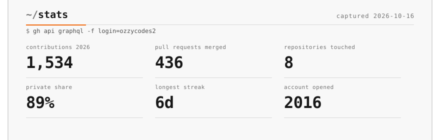
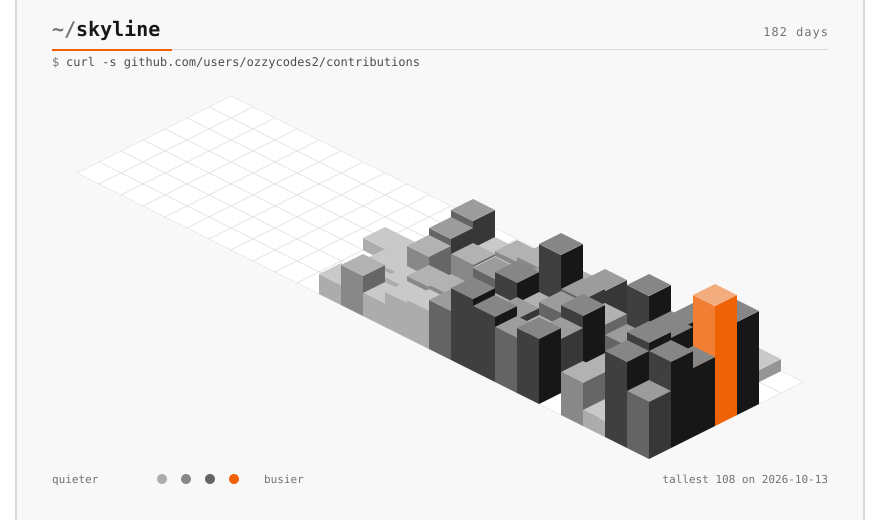
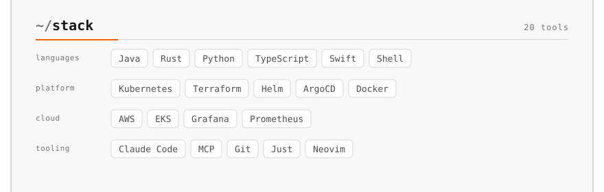
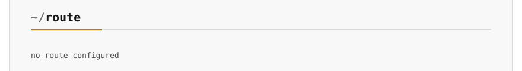
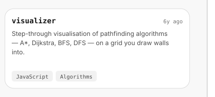
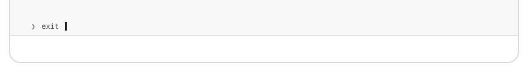

<!-- profile:start -->

<picture><source media="(prefers-color-scheme: dark)" srcset="./assets/dark/header.svg"></picture>
<picture><source media="(prefers-color-scheme: dark)" srcset="./assets/dark/stats.svg"></picture>
<picture><source media="(prefers-color-scheme: dark)" srcset="./assets/dark/contribution-city.svg"></picture>
<picture><source media="(prefers-color-scheme: dark)" srcset="./assets/dark/stack.svg"></picture>
<picture><source media="(prefers-color-scheme: dark)" srcset="./assets/dark/route.svg"></picture>
<picture><source media="(prefers-color-scheme: dark)" srcset="./assets/dark/projects.svg"></picture>
<a href="https://github.com/ozzycodes2/cc-powerline"><picture><source media="(prefers-color-scheme: dark)" srcset="./assets/dark/projects-1.svg"></picture></a><a href="https://github.com/ozzycodes2/visualizer"><picture><source media="(prefers-color-scheme: dark)" srcset="./assets/dark/projects-2.svg"></picture></a>
<a href="https://github.com/ozzycodes2/email-signatures"><picture><source media="(prefers-color-scheme: dark)" srcset="./assets/dark/projects-3.svg"></picture></a><a href="https://github.com/ozzycodes2/facebook-message-parser"><picture><source media="(prefers-color-scheme: dark)" srcset="./assets/dark/projects-4.svg"></picture></a>
<picture><source media="(prefers-color-scheme: dark)" srcset="./assets/dark/footer.svg"></picture>

<!-- profile:end -->

This README builds itself. A daily GitHub Action re-fetches the numbers and
re-renders every panel above from <a href="tools/profile/">tools/profile</a> —
see <a href="tools/profile/README.md">how it works</a>.
