<!-- profile:start -->

<a href="https://github.com/ozzycodes2"></a><a href="https://www.linkedin.com/in/osniel-quintana/"></a><a href="mailto:osniel219@gmail.com"></a>
<a href="https://github.com/ozzycodes2/cc-powerline"></a><a href="https://github.com/ozzycodes2/visualizer"></a>
<a href="https://github.com/ozzycodes2/email-signatures"></a><a href="https://github.com/ozzycodes2/facebook-message-parser"></a>

<!-- profile:end -->

This README builds itself. A daily GitHub Action re-fetches the numbers and
re-renders every panel above from <a href="tools/profile/">tools/profile</a> —
see <a href="tools/profile/README.md">how it works</a>.
